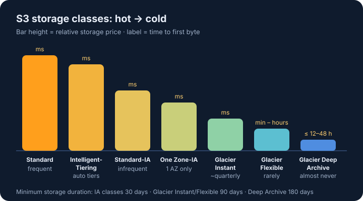

## Two questions decide the class

1. **How often is the data read?** Often → S3 Standard. Rarely → an Infrequent Access or Glacier class.
2. **When it is read, how fast must it come back?** Milliseconds → Standard, Standard-IA, One Zone-IA or Glacier Instant Retrieval. Minutes to hours is fine → Glacier Flexible Retrieval or Glacier Deep Archive.

| Class | Read pattern | First byte | Watch out for |
|---|---|---|---|
| S3 Standard | frequent | milliseconds | highest storage price |
| S3 Intelligent-Tiering | unknown or changing | milliseconds | small monitoring fee per object |
| S3 Standard-IA | infrequent | milliseconds | retrieval fee per GB · 30-day minimum · 128 KB minimum billable size |
| S3 One Zone-IA | infrequent, re-creatable | milliseconds | one AZ — data is lost if that AZ is destroyed |
| S3 Glacier Instant Retrieval | about once a quarter | milliseconds | 90-day minimum |
| S3 Glacier Flexible Retrieval | rarely | 1–5 min (expedited) to 5–12 h (bulk) | 90-day minimum |
| S3 Glacier Deep Archive | almost never | within 12 h (bulk: within 48 h) | 180-day minimum · cheapest |

## Lifecycle rules

A lifecycle rule acts on a whole bucket, a prefix or a tag:

- **Transition** objects to a colder class after N days — e.g. Standard → Standard-IA after 30 days → Glacier Deep Archive after 365 days.
- **Expire** objects, or old versions of them, after N days.
- **Abort incomplete multipart uploads** so half-finished uploads stop costing money.

Objects must stay **at least 30 days** in S3 Standard before a rule can move them to Standard-IA or One Zone-IA.

## Exam keywords

- *"unknown or changing access pattern"* → **Intelligent-Tiering**
- *"rarely accessed, but must be available in milliseconds"* → **Glacier Instant Retrieval**
- *"long-term archive, retrieval within 12–48 hours is acceptable"* → **Glacier Deep Archive**
- *"can be re-created if lost"* → **One Zone-IA**
